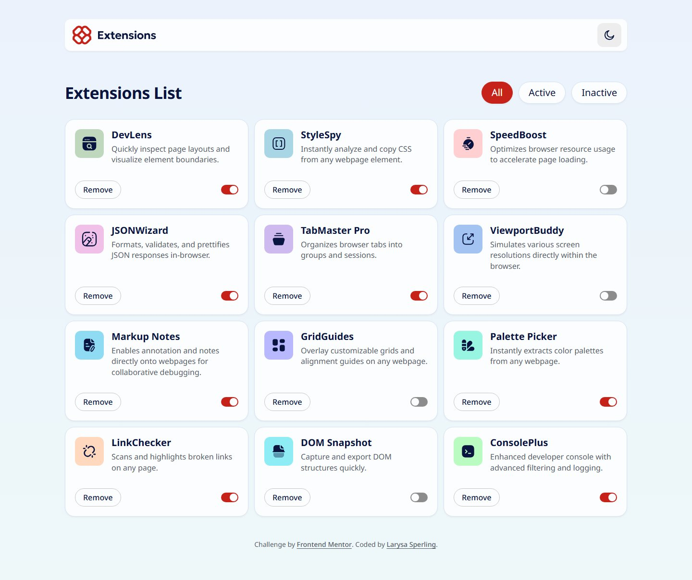

# Frontend Mentor - Browser extensions manager UI solution

This is a solution to the [Browser extensions manager UI challenge on Frontend Mentor](https://www.frontendmentor.io/challenges/browser-extension-manager-ui-yNZnOfsMAp). Frontend Mentor challenges help you improve your coding skills by building realistic projects.

## Table of contents

- [Overview](#overview)
  - [The challenge](#the-challenge)
  - [Extra features](#extra-features)
  - [Screenshot](#screenshot)
  - [Links](#links)
- [Getting started](#getting-started)
- [My process](#my-process)
  - [Built with](#built-with)
  - [Project structure](#project-structure)
  - [What I learned](#what-i-learned)
  - [Continued development](#continued-development)
  - [Useful resources](#useful-resources)
  - [AI Collaboration](#ai-collaboration)
- [Author](#author)

## Overview

### The challenge

Users should be able to:

- Toggle extensions between active and inactive states
- Filter active and inactive extensions
- Remove extensions from the list
- Select their color theme
- View the optimal layout for the interface depending on their device's screen size
- See hover and focus states for all interactive elements on the page

### Extra features

Beyond the challenge requirements, I added:

- **Persistence with `localStorage`** – toggled states, removed extensions and the chosen theme survive a page reload. Reading and writing are wrapped in `try/catch`, so the app still works if storage is unavailable or contains broken JSON.
- **Reset button** – restores all 12 extensions and their initial states from `data.json` (the theme is kept). It appears only when the list differs from the initial data, and inside the empty state when every extension has been removed.
- **System theme** – the first visit follows `prefers-color-scheme`, and the page keeps following live system changes until the user picks a theme manually. A tiny inline script sets the theme before the first paint, so there is no flash of the wrong theme.
- **Empty state** – a message for each filter when there is nothing to show.
- **Accessibility**
  - Semantic landmarks (`header`, `main`, `section`, `footer`), one `h1` and an `h2` per card
  - Native `<input type="checkbox" role="switch">` toggles, so keyboard and screen readers work out of the box
  - Filter buttons expose their state with `aria-pressed` (the CSS styles the same attribute, so visuals and semantics can't drift apart)
  - Descriptive labels: "Remove DevLens", "Switch to dark theme"
  - Focus moves to the list heading after Remove/Reset, instead of being lost on `<body>`
  - Visible `:focus-visible` outlines on every interactive element
  - Hover styles only on devices that support hover (`@media (hover: hover)`)
  - `prefers-reduced-motion` support
  - Colour contrast checked against WCAG AA; three colours were adjusted slightly from the design to pass (see [What I learned](#what-i-learned))
- **Responsive down to 320px** – the filter buttons get more compact on very small screens so they stay in one row.

### Screenshot



### Links

- Solution URL: [GitHub repository](https://github.com/LarysaSperling/browser-extensions-manager-ui-main)
- Live Site URL: [browser-extensions-manager-ui-main-sage.vercel.app](https://browser-extensions-manager-ui-main-sage.vercel.app)

## Getting started

```bash
npm install
npm run dev      # start the dev server at http://localhost:5173
npm run build    # production build into /dist
npm run preview  # preview the production build locally
```

## My process

### Built with

- Semantic HTML5 markup
- CSS custom properties (two layers: palette tokens + semantic tokens for theming)
- Flexbox
- CSS Grid
- Mobile-first workflow
- [React 18](https://react.dev/) – UI library (`useState`, `useEffect`, `useRef`, a custom hook)
- [Vite](https://vitejs.dev/) – build tool and dev server
- Plain CSS, one stylesheet per component – no CSS framework

### Project structure

```
src/
├── App.jsx                 # all state lives here: extensions, filter, theme
├── hooks/
│   └── useLocalStorage.js  # useState that survives a reload
├── components/
│   ├── Header.jsx          # inline SVG logo + theme toggle
│   ├── FilterBar.jsx       # heading + All / Active / Inactive
│   ├── ExtensionList.jsx   # grid of cards or the empty state
│   ├── ExtensionCard.jsx
│   ├── Switch.jsx          # accessible toggle
│   ├── EmptyState.jsx
│   ├── ResetButton.jsx
│   └── Footer.jsx
├── data/data.json
└── index.css               # fonts, design tokens, light/dark themes, shared styles
```

### What I learned

**Derived data instead of duplicated state.** The filtered list is not stored in state – it is calculated from `extensions` and `filter` on every render. Because of that, an extension disappears from the "Active" tab the moment it is switched off, without any extra code:

```jsx
const [extensions, setExtensions] = useLocalStorage(EXTENSIONS_STORAGE_KEY, extensionsData);
const [filter, setFilter] = useState('all');

const visibleExtensions = extensions.filter((ext) => matchesFilter(ext, filter));
const isModified = !isSameAsInitial(extensions); // decides whether Reset is shown
```

**Immutable updates.** `.map()` to change an item, `.filter()` to remove one – always a new array, so React notices the change:

```jsx
setExtensions((prev) =>
  prev.map((ext) => (ext.name === name ? { ...ext, isActive: !ext.isActive } : ext)),
);
```

**Theming with semantic tokens.** Components only use tokens such as `--color-surface` or `--color-accent`. The dark theme is a single block that redefines them – no component CSS had to change:

```css
:root[data-theme='dark'] {
  --color-surface: var(--neutral-800);
  --color-text: var(--neutral-0);
  --color-accent: var(--red-400);
}
```

**Inline SVG + `currentColor`.** The logo text has a hard-coded colour in `logo.svg`, which an `` can't change. As inline SVG with `fill="currentColor"` it follows the theme automatically.

**A custom hook.** `useLocalStorage` has the same API as `useState`, so switching to persistence changed exactly one line in `App.jsx`. The theme deliberately does *not* use it: the hook writes on the first render, which would lock in the system theme. Instead, the theme is saved only after an explicit click.

**`useEffect` cleanup.** The live system-theme listener is removed in the effect's cleanup function to avoid a memory leak:

```jsx
useEffect(() => {
  const mediaQuery = window.matchMedia('(prefers-color-scheme: dark)');
  function handleChange(event) {
    if (getSavedTheme() !== null) return; // the user's choice wins
    setTheme(event.matches ? 'dark' : 'light');
  }
  mediaQuery.addEventListener('change', handleChange);
  return () => mediaQuery.removeEventListener('change', handleChange);
}, []);
```

**Contrast is worth measuring.** Checking the design colours against WCAG AA showed three issues. I kept the original hues and only adjusted lightness, so the result stays close to the design:

| Element | Design | Fixed |
|---|---|---|
| White text on the selected filter's hover red | 4.04:1 (`Red 500`) | 4.68:1 (needs 4.5:1) |
| Focus ring on the light background | 2.89:1 (`Red 400`) | 3.66:1 with `Red 500` (needs 3:1) |
| Inactive switch track vs. card – light / dark | 1.66:1 / 2.15:1 | 3.28:1 / 3.22:1 (needs 3:1 for UI components) |

### Continued development

- Store only the user's *changes* (removed names, toggled states) instead of the whole array, so new extensions added to `data.json` would still show up for returning users.
- Add tests with Vitest and React Testing Library (toggle, filter, remove, reset).
- Try the same project in TypeScript.

### Useful resources

- [React docs – Choosing the state structure](https://react.dev/learn/choosing-the-state-structure) – the "avoid redundant state" principle behind the derived filtered list.
- [React docs – Reusing logic with custom hooks](https://react.dev/learn/reusing-logic-with-custom-hooks) – how to write `useLocalStorage`.
- [MDN – ARIA: switch role](https://developer.mozilla.org/en-US/docs/Web/Accessibility/ARIA/Roles/switch_role) – building an accessible toggle on top of a checkbox.
- [MDN – :focus-visible](https://developer.mozilla.org/en-US/docs/Web/CSS/:focus-visible) – keyboard-only focus outlines.
- [WebAIM Contrast Checker](https://webaim.org/resources/contrastchecker/) – checking colour pairs against WCAG.

### AI Collaboration

I used **Claude Code** (Anthropic's Claude in the terminal) as a pair programmer.

- **How:** I first asked it only to research the challenge – read the brief, the style guide and every design file – and write a report with requirements, open questions and a step-by-step plan. I made the key decisions myself (React + Vite, which extra features to build, how filtering should behave, inline SVG for the logo). Then it implemented one small step at a time, explaining the code and the concepts behind it. After each step I tested in the browser, asked questions and committed the changes myself. The plan is tracked in [`PLAN.md`](./PLAN.md).
- **What worked well:** small, reviewable steps; explanations of *why*, not just *what* (immutable updates, derived state, `useRef`, `useEffect` cleanup); automated checks in headless Chrome for the keyboard order, horizontal overflow at 320px, console errors and colour contrast.
- **What I watched for:** I reviewed every change before committing and pushed back on layout details (e.g. the filter buttons wrapping at 320px, and the desktop heading/filter alignment).

## Author

- GitHub – [@LarysaSperling](https://github.com/LarysaSperling)
- Frontend Mentor – [@LarysaSperling](https://www.frontendmentor.io/profile/LarysaSperling)
